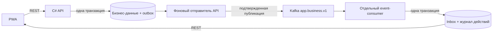

# Kafka в генерируемых приложениях

## План реализации

1. Добавить официальный Apache Kafka 4.1.2 (KRaft, один узел) и отдельный .NET consumer в Compose. Брокер доступен только во внутренней сети, данные хранятся в томе.
2. Зафиксировать контракт событий до генерации кода: успешные изменяющие операции и основные действия интерфейса, тема `app.business.v1`, версия 1, ключ бизнес-операции, ID события, пользователь, результат операции.
3. Дать генерируемому backend доверенный `BusinessEvents.Enqueue`: бизнес-запись и outbox сохраняются в одной PostgreSQL-транзакции. Отправитель подтверждает публикацию только после ответа Kafka. Consumer сохраняет историю действий и inbox в одной транзакции; offset подтверждает после commit.
4. Проверять будущие запуски по реальным бизнес-запросам: заголовок события, содержимое outbox, публикация и обработка, сохранение после перезапуска consumer. Проверки не исполнять во время этой доработки.
5. Обновить промпты, документацию, фиксацию приемки и GitLab CI. GitLab остается конфигурацией до предоставления доступа и runner.

## Границы

Kafka — реальный внутренний транспорт приложения. Платежи, карты, внешние данные и уведомления остаются mock-провайдерами. Consumer не выполняет настоящих внешних отправок. События не меняют обязательные поля REST-ответа; их ID передаются отдельным заголовком. Гарантия доставки — at least once, повторная обработка убирается inbox по eventId. Это не распределенная транзакция и не гарантия exactly once между PostgreSQL и Kafka. Один брокер предназначен для хакатона, без отказоустойчивого кластера.

Официальные материалы: [Apache Docker](https://kafka.apache.org/41/getting-started/docker/), [пример KRaft](https://github.com/apache/kafka/blob/4.1.1/docker/examples/docker-compose-files/single-node/plaintext/docker-compose.yml), [.NET client и offsets](https://docs.confluent.io/kafka-clients/dotnet/current/overview.html), [фиксированный клиент Confluent.Kafka 2.15.1](https://www.nuget.org/packages/Confluent.Kafka/2.15.1).

## Реализованные компоненты

- `shared/events.py` выводит события из всех non-GET endpoints и submit-действий UI. Имена событий — `<endpointId>.completed`. Событие содержит точный успешный REST-результат, статус, актёра, бизнес-ключ и ссылки на требования. Контракт сохраняется в backend/, scripts/, docs/ и reports/ до реализации, затем проверяется при сборке и выпуске.
- `templates/assets/backend/BusinessEvents.cs`: транзакционный Enqueue, фоновые публикации, настоящий .NET Kafka-клиент, consumer, защищённые API журнала и доказательств. API и consumer используют один образ и разные режимы процесса. Consumer не регистрирует бизнес-маршруты.
- Outbox подтверждается после Kafka delivery report. При сбое между публикацией и отметкой БД возможна повторная доставка; уникальный eventId в inbox сохраняет один эффект в журнале. При ошибке обработки consumer завершается и после перезапуска читает с подтверждённого offset, не перескакивая ошибочную запись.
- Бизнес-обработчик использует ту же connection/transaction для своей записи и Enqueue, затем commit. Ключ повторной операции и её результат должны быть стабильны; изменённый результат с прежним ключом даёт конфликт. Если бизнес-записи выполняются через другой connection или вне этой транзакции, атомарности нет — это ограничение контролируется инструкцией реализации и требует проверки конкретного сгенерированного обработчика.
- `worker/domain_checks.py` требует X-Business-Event-Id от реального запроса и сравнивает сохранённое событие с его HTTP-результатом. Для неуспеха контролирует отсутствие нового события. Метаданные сами по себе не засчитываются.
- `worker/events_checks.py` проверяет покрытие контрактных endpoints, доставку и совпадение offsets, один эффект в журнале, сохранение событий после перезапуска Kafka/backend/consumer и повторную реальную публикацию через брокер. Дополнительный admin replay включён только при TEST_CLOCK_ENABLED=true; финальный deployment выключает этот режим. Сценарии записаны для будущих запусков, сейчас не исполнялись.
- Файлы будущих проверок: project/event-results/business-events.jsonl, delivery.json, persistence.json; общий reports/pipeline-evidence.json содержит ссылки на выполненные команды и контракт Kafka. Локальные технические токены в эти файлы не записываются. Доступ к самим событиям ограничен текущим demo-актёром; это не производственная система авторизации.
- В интерфейсе есть сворачиваемый журнал; он получает данные только из consumer-проекции. Основной экран продукта остаётся GeneratedPanel.

## Запуск пользователем

Изменения действуют только для новых генераций. Уже созданные приложения не переделывались. Первый запуск потребует скачать образ apache/kafka:4.1.2 и NuGet-клиент. Kafka не требует открывать порт VM: frontend остаётся единственной опубликованной частью приложения.

GitLab-репозиторий и runner не подключены. Подготовленный YAML повторяет будущую локальную приёмку; фактическое исполнение и совместимость конфигурации конкретного runner предстоит подтвердить после выдачи доступа. Версия самого GitLab не проверялась.

Резервная копия: backups/generator-before-kafka-20261031.tar.gz.

Данные брокера размещены в /var/lib/kafka/data — каталоге с правами appuser из [официального Dockerfile](https://github.com/apache/kafka/blob/4.1.2/docker/jvm/Dockerfile). Тема и offsets сохраняются в kafka-data; временный каталог /tmp для постоянного тома не используется.

## Что проверено при внедрении

31.10.2026: Python-модули скомпилированы; .NET backend с закреплённым Confluent.Kafka успешно собран; Angular с журналом действий успешно собран; Docker-образ worker собран. Исходники проверены отдельным reviewer без запуска кода. Брокер, consumer и новый генерируемый проект в ходе этой работы не запускались; фактическое прохождение новой приёмки пока не подтверждено. Тестовые наборы и запросы генерации Qwen не выполнялись по указанию пользователя. Worker обновлён только локально; VM не менялась.
